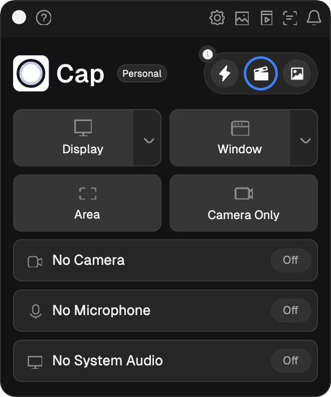
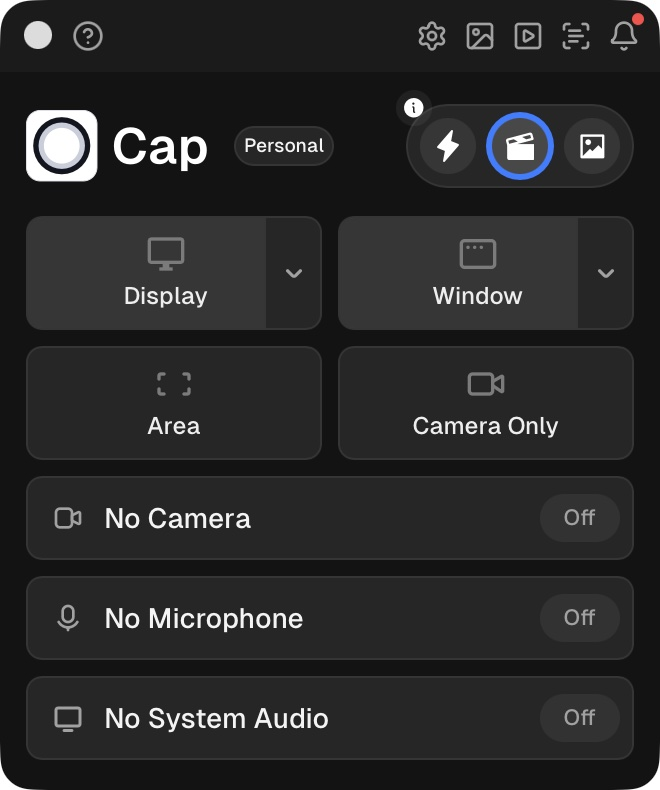

<div align="center">

<h1>Cap Avalonia</h1>

<p><strong>Cap’s compact desktop recorder, rebuilt with Avalonia.</strong></p>

An independent, local-first desktop port for recording your screen, camera, and microphone—then reviewing and exporting the result on your own device.

[Download the latest release](https://github.com/kris70lesgo/cap-avalonia-port/releases/latest) · [View the source](https://github.com/kris70lesgo/cap-avalonia-port) · [Explore upstream Cap](https://github.com/CapSoftware/Cap)

[](https://github.com/kris70lesgo/cap-avalonia-port/releases/latest)


<br />



</div>

## A familiar recorder. Files stay local.

Cap Avalonia recreates Cap’s compact recorder and settings experience in one Avalonia codebase for macOS, Windows, and Linux. Record a display, window, area, or camera; add a circular webcam overlay and audio inputs; then save, trim, and export the recording locally.

This port does not connect to Cap accounts, cloud uploads, share links, or hosted services. Your recordings, screenshots, and preferences stay on your device.

## Download

The release archives include the .NET runtime. **FFmpeg is a separate dependency** for recording and video editing; install it as described in [FFmpeg setup](#ffmpeg-setup).

| Platform | Download | Launch |
| --- | --- | --- |
| macOS 13+ · Apple Silicon | [CapAvalonia-osx-arm64.zip](https://github.com/kris70lesgo/cap-avalonia-port/releases/latest/download/CapAvalonia-osx-arm64.zip) | Extract, then open `CapAvalonia-final.app` |
| Windows · x64 | [CapAvalonia-win-x64.zip](https://github.com/kris70lesgo/cap-avalonia-port/releases/latest/download/CapAvalonia-win-x64.zip) | Extract, then open `CapAvalonia.exe` |
| Linux · x64 | [CapAvalonia-linux-x64.zip](https://github.com/kris70lesgo/cap-avalonia-port/releases/latest/download/CapAvalonia-linux-x64.zip) | Extract, then run `./CapAvalonia` |

See the [release page](https://github.com/kris70lesgo/cap-avalonia-port/releases) for version details.

## At a glance

| | |
| --- | --- |
| **Capture** | Display, selected window, area, or camera-only recording; still screenshots |
| **Audio and camera** | Microphone, system-audio loopback, and circular webcam picture-in-picture |
| **Local library** | Browse recordings and screenshots; import, rename, copy media to the clipboard, or move items to the system Trash |
| **Editing** | Preview a recording, set trim points, and export an MP4 with file-size and quality choices while preserving the original |
| **Screenshots** | Annotate with pen, arrows, rectangles, highlights, and text; export a new PNG |
| **Workflow** | Scrolling teleprompter, unread activity, configurable shortcuts, persistent settings, and local backup automations |

The interface includes the compact recorder and all 13 settings pages. Capture choices, library paths, editor trim points, teleprompter text, shortcuts, and settings persist between launches.

## The port in screenshots

The original and Avalonia recorder captures below have the same 660 × 790 image dimensions. The port targets Cap’s compact 330 × 395 logical-pixel recorder window.

<p align="center">
  <a href="screenshots/cap-desktop-reference.jpg"></a>
  &nbsp;
  <a href="screenshots/avalonia-final.jpg"></a>
</p>
<p align="center"><sub>Cap desktop reference · Avalonia port</sub></p>

## Platform support

| Platform | Capture backend | Current status |
| --- | --- | --- |
| **macOS · Apple Silicon** | FFmpeg AVFoundation; macOS `screencapture` for full-display screenshots | Screen recording and screen + camera + microphone recording were verified. Grant screen, camera, and microphone permissions when prompted. |
| **Windows · x64** | FFmpeg DirectShow; native window-handle capture | Release package builds. Device capture has not yet been validated on Windows. |
| **Linux · x64** | FFmpeg V4L2/PulseAudio; X11/XWayland display capture | Release package builds. Device capture has not yet been validated on Linux. Native Wayland portal capture is not implemented. |

### Compatibility notes

- System audio needs an available loopback source, such as BlackHole on macOS or a monitor/Stereo Mix source on Windows and Linux.
- Windows and X11/XWayland Linux can capture a selected window by its native handle. On macOS, the Window target captures the selected screen rectangle, so windows layered over it can remain visible.
- Linux window selection uses `xwininfo`; display capture requires X11 or XWayland.
- Global shortcut registration uses Carbon on macOS. Shortcuts are app-focused on Windows and Linux.
- The floating stop control is excluded from macOS capture, but may appear in recordings on other platforms.
- The local editor supports preview, trim, and MP4 export. Captions, transitions, cursor effects, and multi-track editing are not included.

## Get started

### 1. Install FFmpeg

The release packages do not bundle FFmpeg. Install `ffmpeg`, `ffprobe`, and `ffplay`, and make sure they are available on `PATH`.

- **macOS:** `brew install ffmpeg`
- **Windows:** install an FFmpeg build from the [FFmpeg download page](https://ffmpeg.org/download.html) and add its `bin` folder to `PATH`.
- **Linux:** install `ffmpeg` using your distribution’s package manager.

For capture devices, use an FFmpeg build with the relevant backend: AVFoundation on macOS, DirectShow on Windows, and V4L2/PulseAudio on Linux. Video preview uses `ffplay`; media inspection and trim workflows use `ffprobe`.

### 2. Launch the app

Download the archive for your platform, extract it, and open the app listed in the [download table](#download). On Linux, run `./CapAvalonia` from the extracted folder. Grant screen-recording, camera, and microphone permissions for the features you use.

The macOS app is ad-hoc signed. Privacy permissions may be associated with the specific build, so after replacing the app, reopen System Settings and re-enable Cap Avalonia if capture permission is no longer recognized.

### 3. Choose where media is stored

By default, recordings, screenshots, and preferences are stored under the platform’s application-support directory in `CapAvalonia/`. Change the recordings location in Settings. The Automations page can copy new recordings and screenshots into separate local backup folders.

## Build from source

You need the [.NET 9 SDK](https://dotnet.microsoft.com/download/dotnet/9.0) or newer.

```sh
git clone https://github.com/kris70lesgo/cap-avalonia-port.git
cd cap-avalonia-port
dotnet run
```

The UI uses Avalonia 12.1.3 and targets macOS, Windows, and Linux.

### Create release packages

```sh
# macOS Apple Silicon .app bundle
scripts/package-macos.sh

# Portable Windows and Linux x64 archives
scripts/package-portable.sh win-x64
scripts/package-portable.sh linux-x64
```

Packages are self-contained with the .NET runtime. To bundle `ffmpeg`, `ffprobe`, and `ffplay`, set `CAPAVALONIA_FFMPEG_DIR` to a directory containing those executables before packaging. On Windows, use the `.exe` versions. Without bundled FFmpeg tools, users must install FFmpeg separately and put it on `PATH`.

## How the port was built

### What changed

Cap’s desktop experience is recreated with Avalonia XAML and C#. The recorder, settings, media library, and editing workflows share one UI codebase across three desktop platforms. FFmpeg supplies the capture and media pipeline, with AVFoundation, DirectShow, and V4L2/PulseAudio handling platform-specific devices.

The largest change was replacing hosted recording flows with a complete local file lifecycle: start and stop capture, recover an interrupted recording when enabled, add media to the library, and open it in the editor. Matching Cap’s small recorder also required deliberate sizing, typography, spacing, dark controls, and platform-specific title-bar adjustments instead of default Avalonia styling.

### What is different

Cap’s account, upload, share-link, and hosted collaboration features are not connected. The port focuses on local capture and media workflows. Screen and device permissions, system-audio loopback sources, and available FFmpeg backends vary by platform; Linux Wayland portals are not yet supported.

### Time and validation

The work spanned 16 calendar days from the first project commit on 6 October 2026 to release packaging on 22 October. Hours were not tracked, so this write-up does not estimate them. macOS screen-only capture and screen + camera + microphone capture were checked as playable H.264/AAC MP4 files. Webcam composition and audio mixing were smoke-tested with synthetic media. Windows and Linux packages were built and packaged, but device capture still needs validation on those operating systems.

## License and attribution

Cap Avalonia is licensed under [AGPL-3.0](LICENSE). It is an independent port of the [Cap desktop application](https://github.com/CapSoftware/Cap) by Cap Software; it is not an official Cap release. Bundled fonts include their own license at [`assets/Fonts/OFL.txt`](assets/Fonts/OFL.txt).
