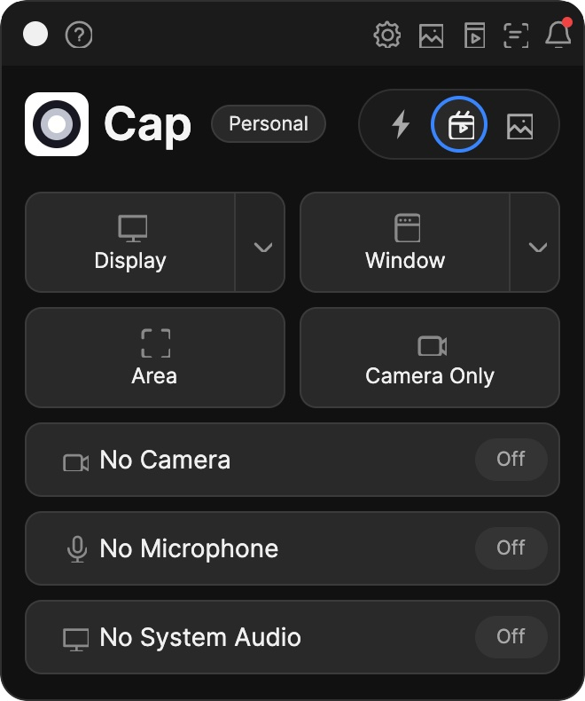

# Cap Avalonia

A cross-platform Avalonia port of Cap's desktop app. It recreates the compact recorder window and all 13 Settings pages, with local Recordings and Screenshots libraries. Local workflows include display recording, screenshot capture, selectable displays and crop areas, camera and microphone inputs on macOS, webcam picture-in-picture, video trimming and export, screenshot annotation with pen, arrows, rectangles, highlights and text, a scrolling teleprompter, unread activity, media import, clipboard copy, deletion to the system Trash, configurable shortcuts, and local backup automations. Recorder mode, capture devices, library paths, trim points, teleprompter text, shortcuts, and settings persist between launches.

This is a local recorder and library; Cap's account, upload, share-link, and other online services are not connected. Camera and microphone selection uses FFmpeg AVFoundation on macOS. Screen recordings can include a circular webcam overlay and mix selected microphone and system-audio inputs. System audio requires an installed loopback device such as BlackHole. The Window target records a selected screen rectangle, so windows layered over it remain visible. The editor previews recordings, sets trim points, and exports MP4 clips; captions, transitions, cursor effects, and multi-track editing are not included. Screenshot annotations export as a new PNG. The Automations page can copy new recordings and screenshots to separate local backup folders. Shortcut registration uses Carbon on macOS; app-focused shortcuts work on other platforms. Cap's CLI, automatic updates, and online license services are not connected. The floating stop control is marked capture-excluded on macOS and may appear in recordings on other platforms.

The reference application is [Cap](https://github.com/CapSoftware/Cap), an open-source screen recorder by Cap Software. This project adapts its desktop interface under the AGPL-3.0 license. See [LICENSE](LICENSE) for the license and the upstream copyright notice.

## Run

Requires the .NET 9 SDK or newer.

```sh
dotnet run
```

The UI is built with Avalonia 12.1.3 and targets macOS, Windows, and Linux.

To build a self-contained macOS app bundle on Apple Silicon, run `scripts/package-macos.sh`. It creates `.build/CapAvalonia-final.app`; open it with `open .build/CapAvalonia-final.app`. The script accepts an optional runtime identifier and output bundle path, for example `scripts/package-macos.sh osx-arm64 "$PWD/.build/CapAvalonia-preview.app"`. A self-contained bundle still expects FFmpeg tools on `PATH` for capture and video editing.

Recording and video editing require FFmpeg installed and available on `PATH`. Video preview uses `ffplay`, and clip inspection uses `ffprobe`; both ship with standard FFmpeg packages. macOS full-display screenshots use the system `screencapture` utility; area screenshots and Windows/Linux screenshots use FFmpeg. macOS camera and microphone capture uses FFmpeg's AVFoundation input. Capture may require granting screen, camera, or microphone access to Cap Avalonia in System Settings. Media and preferences are saved under the platform's application support directory in `CapAvalonia/`; the recordings folder can be changed in Settings.

## Recorder window comparison

The recorder window recreates Cap's 330×395 home screen. These comparison screenshots show the initial visual pass captured on 2026-10-05.

| Cap desktop reference | Avalonia first pass |
| --- | --- |
|  |  |
